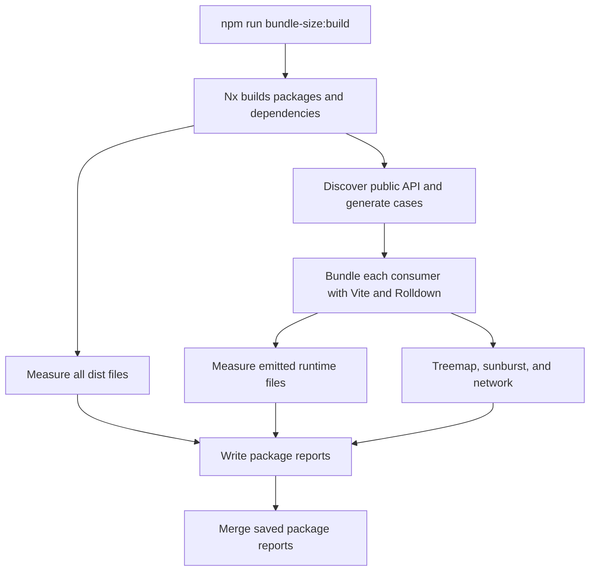
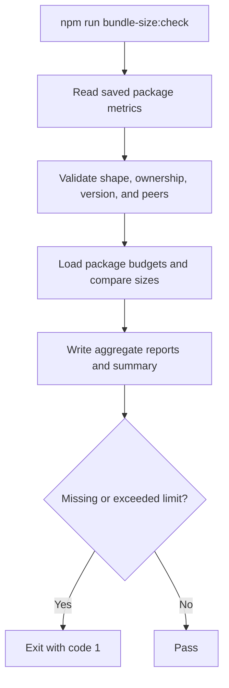

# Bundle Size PDR

Status: **Implemented**

## Table of Contents

- [Purpose](#purpose)
- [Composition](#composition)
- [Internal Structure & Reuse Potential](#internal-structure--reuse-potential)
- [External Tool Integration](#external-tool-integration)
- [Architecture & Features](#architecture--features)
- [Accessibility Highlights](#accessibility-highlights)
- [Internationalization, RTL, and Mobile Considerations](#internationalization-rtl-and-mobile-considerations)
- [Competitive Research](#competitive-research)
- [Code Examples](#code-examples)

## Purpose

Bundle analysis helps contributors understand the cost of a public import and review changes that increase it. It answers two questions:

1. How much build output does a package produce?
2. How much JavaScript, CSS, and other runtime output does an application receive when it bundles a particular import?

These are different measurements. A small wrapper can include substantial accessibility and interaction dependencies. A package with many components can still support small imports when tree shaking removes unused code.

The design provides automatic public API coverage, interactive composition reports, and package-owned size budgets. Contributors generate measurements locally and run the same budget check used in CI. The analysis runs in the repository checkout using development dependencies; it needs no hosted analysis service or organization-specific access.

### Unique Attributes

- Discover public entries and runtime exports from package manifests and built output instead of maintaining component lists.
- Measure package output and production consumer imports separately, including their different treatment of declarations and source maps.
- Include reachable CSS, assets, and transitive dependencies in consumer builds while externalizing each package's declared peers.
- Keep reviewed limits in each package's `bundle-size.json`, with isolated build and check targets.
- Separate report generation from enforcement: `bundle-size:build` measures; `bundle-size:check` reads saved results.
- Reuse Visualizer's treemap, sunburst, and network views to explain the same measured build.

## Composition

This is a shared developer-tooling pattern. It adds observation and budget enforcement around existing package builds.

| Part | Responsibility |
| --- | --- |
| [Existing package builds](../../../configs/tsdown.config.mts) | Produce the artifacts whose publication contract is being measured |
| [bundle-discovery.ts](../../../scripts/bundle-discovery.ts) | Resolve public entries, inspect runtime exports with the TypeScript AST/checker, and generate stable consumer cases |
| [bundle-analysis.ts](../../../scripts/bundle-analysis.ts) | Build fixtures, measure files, serialize reports, and check saved measurements against budgets |
| [bundle-report.css](../../../scripts/bundle-report.css) | Style the small standalone HTML index |
| Package `bundle-size.json` | Store that package's reviewed raw-output and gzip-consumer limits |
| Package `package.json` | Supply public exports, version, peer dependencies, and package scripts |
| [nx.json](../../../nx.json) | Order analysis after package builds and define shared target behavior |
| [CI workflow](../../../.github/workflows/ci.yaml) | Generate reports, then enforce budgets in the existing CI job |
| [Regression tests](../../../scripts/test/bundle-analysis.node.test.ts) | Exercise discovery, measurement accounting, and budget contracts |

Most packages build with tsdown/Rolldown. [Design Tokens](../../../packages/@godaddy/design-tokens/package.json) uses Style Dictionary and publishes heterogeneous outputs. The analyzer consumes each package's existing artifacts rather than imposing one publishing build.

## Internal Structure & Reuse Potential

### File structure

```text
.
├── package.json                       # Root build/check commands
├── nx.json                            # Shared target defaults
├── packages/
│   ├── @bento/button/
│   │   ├── package.json               # Version, exports, peers, and package scripts
│   │   └── bundle-size.json           # Reviewed limits
│   └── .../bundle-size.json
├── scripts/
│   ├── bundle-discovery.ts            # Public API -> consumer cases
│   ├── bundle-analysis.ts             # Cases -> measurements -> reports/checks
│   ├── bundle-report.css
│   └── test/bundle-analysis.node.test.ts
├── .github/workflows/ci.yaml
└── .bundle-analysis/                   # Generated and ignored
    ├── index.html
    ├── metrics.json
    ├── public-api.json
    ├── summary.md
    └── packages/@bento/button/
        ├── index.html
        ├── metrics.json
        ├── public-api.json
        ├── summary.md
        ├── entries/<case-id>.mjs
        ├── consumers/<case-id>/
        └── reports/<case-id>/
            ├── treemap.html
            ├── sunburst.html
            └── network.html
```

Package budgets live beside the package manifest. Generated metrics follow the same package path under `.bundle-analysis/`, where disposable fixtures and reports stay together. Existing publication `files` lists keep the budget configuration out of published package contents.

### Separation of responsibilities

Discovery answers **what can be imported?** Analysis answers **what does that import produce, and is its saved size within budget?** Keeping these modules separate makes AST/export resolution independently understandable and testable. File compression, HTML rendering, and CLI orchestration do not belong in discovery.

Shared Vite settings are inline in the analyzer. Package manifests provide version and peers; package JSON provides limits. No additional executable configuration module, dedicated Nx analysis project, or script-specific tsconfig is needed.

### Data flow

```text
package.json + built files
          │
          ▼
    PublicEntry[]        Catalog of public paths, runtime names, and exclusions
          │
          ▼
    ConsumerCase[]       Imports to retain, each with a stable ID
          │
          ▼
    ESM fixtures → Vite/Rolldown → emitted files → Measurement[]
                                                      │
                    metadata + entries + cases ───────┤
                                                      ▼
                                                    Report
                                                      │
                                               saved metrics.json
                                                      │
                        bundle-size.json → Budgets → budget diagnostics
```

### Workspace and package metadata

`Workspace` contains manifest information plus the absolute package root. `PackageMetadata` is the smaller record saved with measurements:

```ts
// Shape example; values are read from the package manifest on each build.
const workspace = {
  name: '@godaddy/antares',
  root: '/checkout/packages/@godaddy/antares',
  version: '0.11.0',
  peerDependencies: { react: '^19.0.0', 'react-dom': '^19.0.0' }
};

const metadata = {
  name: '@godaddy/antares',
  version: '0.11.0',
  externals: ['react', 'react-dom']
};
```

The saved external list contains sorted peer names. Peer version ranges remain in the manifest.

### PublicEntry and ConsumerCase

`PublicEntry` describes one resolved export, including its target relative to the repository root:

```ts
const entry = {
  package: '@godaddy/antares',
  from: '@godaddy/antares/Button',
  target: 'packages/@godaddy/antares/dist/exports/Button.mjs',
  kind: 'javascript',
  exports: ['Button', 'ButtonContext', 'CloseButton', 'LinkButton']
};
```

An optional `reason` makes an entry inventory-only. Eligible JavaScript with four runtime names produces five `ConsumerCase` records: one retaining all four names and one for each name. For example:

```ts
const buttonCase = {
  id: 'auto-export-godaddy-antares-Button-Button-dd1d59573f68',
  package: '@godaddy/antares',
  scope: 'export',
  from: '@godaddy/antares/Button',
  names: ['Button']
};
```

Its fixture retains the import through a visible reference:

```js
import { Button as fixture0 } from '@godaddy/antares/Button';
globalThis.__bundle_fixture__ = [fixture0];
```

An empty `names` array produces a side-effect import. A fixture measures importing code; it does not render the component or execute browser interactions.

The ID contains a filename-safe readable prefix and the first 12 SHA-256 hex characters of the original JSON-serialized `[scope, from, name]` tuple. Implementation bytes are not part of the hash, so ordinary code changes keep the same budget key. Developers copy generated IDs from reports.

### Measurement, Report, and Budgets

A consumer measurement records the resulting files and bytes:

```ts
// Illustrative sizes, not a measured Button result.
const measurement = {
  id: 'auto-export-godaddy-antares-Button-Button-dd1d59573f68',
  kind: 'consumer',
  package: '@godaddy/antares',
  raw: 12000,
  gzip: 4000,
  brotli: 3500,
  groups: { esm: 11000, css: 1000 },
  files: [
    { path: 'assets/Button.js', raw: 11000 },
    { path: 'style.css', raw: 1000 }
  ]
};
```

Its ID matches the case and the `consumerBudgets` key. Output measurements instead use the package name as ID, `kind: 'output'`, and raw/category totals. `groups` always contains raw bytes; consumer file paths are relative to that case's output directory.

```ts
interface Report {
  packages: PackageMetadata[];
  toolchain: Record<string, string>;
  measurements: Measurement[];
  publicEntries: PublicEntry[];
  cases: ConsumerCase[];
}

interface Budgets {
  output: Record<string, number>;   // Package name -> maximum raw bytes
  consumer: Record<string, number>; // Case ID -> maximum gzip bytes
}
```

A package report contains one metadata record and one output measurement. Aggregation combines reports with consistent recorded toolchains and unique identities; package versions and peer lists can differ.

Toolchain metadata records installed root tools and the running Node version. Reports do not record a Git commit or fingerprint source changes; regenerate reports after relevant package or tool changes. The in-development report has no version marker; validation checks required fields and package ownership metadata.

## External Tool Integration

| Tool | Role | Integration boundary |
| --- | --- | --- |
| TypeScript compiler API | Find runtime exports, aliases, and star re-exports without evaluating modules | Built JavaScript and manifest export targets |
| Existing tsdown/Style Dictionary builds | Produce package output | Publishing behavior remains package-owned |
| Vite / Rolldown | Bundle a production consumer with tree shaking, CSS, and assets | One build per generated import case |
| Size Limit + `@size-limit/file` | Measure emitted files using gzip and Brotli | Final file totals drive budgets |
| Rollup Plugin Visualizer | Explain module composition and import relationships | Three HTML views of that same consumer build |
| Nx | Schedule package builds and analysis targets | Existing build dependency graph and cache |

The Size Limit Rolldown plugin alone does not cover CSS according to its reviewed documentation. Vite handles the consumer build, including CSS; Size Limit's file plugin measures its output. This separates bundling from compression and avoids introducing a different consumer bundler solely for measurement.

Vite runs with production mode and `process.env.NODE_ENV`, ES2022 target, minified ESM, source maps, no project config/env file/public directory, `cssCodeSplit: false`, `assetsInlineLimit: 0`, and module preload disabled. Bare imports resolve through the checkout's linked workspace packages.

Each measured package externalizes its own `peerDependencies` and their subpaths. Other reachable dependencies remain bundled. Antares therefore excludes React peers while including reachable React Aria, Visx, Embla, and Bento code. Peer externalization follows the measured package, not a global React-only rule.

All three Visualizer plugins run during the same consumer build. The installed templates provide their own layouts and colors; there is no public theme option in the reviewed version. Tool versions are captured in each report, and [package-lock.json](../../../package-lock.json) pins the installed dependency graph.

## Architecture & Features

### Workspace scope

The analysis covers library and development package workspaces. Documentation applications are excluded. A workspace marked `private: true` remains part of the source repository; its output is measured, while public consumer fixtures are reserved for publishable packages.

| Workspace category | Characteristics that affect measurement |
| --- | --- |
| Runtime libraries | Measure public roots and subpaths, each runtime export, and reachable CSS, assets, and transitive dependencies |
| Token/data packages | Handle heterogeneous JS, CSS, SCSS, JSON, and declaration exports rather than assuming a root runtime entry |
| Types-only packages | Measure build output and inventory entries without creating artificial browser fixtures |
| Development packages | `private: true`; record build output and entry inventory without public browser fixtures |
| Documentation apps | Storybook and Next/Fumadocs mix product code with app infrastructure; app/route performance is separate work |

The detailed catalog is generated from manifests and built files in `public-api.json`; `metrics.json` retains cases and measurements. This avoids maintaining a second export or dependency registry in the PDR.

### Coverage and exclusions

| Resource | Output/inventory treatment | Consumer treatment |
| --- | --- | --- |
| Public JavaScript | Count `dist/`; catalog runtime names | Full entry plus one case per runtime export |
| Public CSS/JSON | Count output; catalog resource | One entry case; use `default` for CSS Module/JSON bindings where applicable |
| Declarations or empty type-only module | Count output; record exclusion reason | No artificial browser fixture |
| SCSS/source/preprocessor export | Count emitted output; record reason | Requires a consumer-specific compiler |
| Package metadata | Catalog entry; count bytes only when in `dist/` | No runtime case |
| Standalone non-module asset | Count output; catalog with reason | Included when referenced and emitted by a consumer |
| Unpublished internal component | Included in package artifacts as emitted | Included transitively when reached by a public import |
| `private: true` package | Count output and inventory entries | No public consumer cases |
| Documentation app | Excluded from this package analysis | No library-cost budget |
| Runtime-fetched resource | Loader/emitted bytes remain measurable | Remote response bodies are outside bundle metrics |

Contexts, helpers, variants, and date utilities are runtime exports when published as values. They receive the same automatic treatment as components. `@bento/types` still has an output budget despite producing no useful browser runtime.

`@godaddy/generate-cdn-url` is an ordinary measured utility. The analysis does not fetch URLs or maintain a separate CDN metric. SVG loaders and sprite helpers are included when reachable; resource bodies fetched after startup are outside emitted bundles.

### Public API discovery

1. Read workspace manifests and resolve `exports`; fall back to `module`, then `main`, when exports are absent.
2. Follow supported import/module/browser/production/default conditions in declared order. This is the measurement's supported resolution policy, not every possible Node condition.
3. Expand a single wildcard against actual files. Explicit entries, including `null` exclusions, override patterns. Reject unsafe paths, unsupported/ambiguous patterns, and missing targets.
4. Use TypeScript's AST/checker to follow aliases and star re-exports and identify runtime values without importing component modules.
5. Preserve inventory-only entries with reasons and generate stable cases for eligible imports. Reject duplicate IDs.

Antares's `"./*"` mapping expands against `dist/exports/*.mjs`. A built `Button.mjs` yields `@godaddy/antares/Button`, preserving case. Its package root and each subpath have separate measurements. `@bento/button` is an independent workspace; a subpath such as `@godaddy/antares/Button` is owned by Antares.

### Measurement model

| Metric | Files included | Purpose |
| --- | --- | --- |
| Output raw | Every `dist/` file: ESM, CJS, CSS, declarations, maps, and assets | Track package build-output growth |
| Consumer raw | Runtime files emitted by that independent production consumer | Inspect bundled JS/CSS/assets before compression |
| Consumer gzip | Sum of independently gzip-compressed runtime files | Enforce consumer budget |
| Consumer Brotli | Sum of independently Brotli-compressed runtime files | Additional transfer-size comparison |

Gzip and Brotli are lossless compression formats commonly used by HTTP servers. They represent alternative encodings of the same files and are not added together. The installed file plugin uses gzip level 9 and Brotli quality 11; production servers can use different settings.

```text
entry.js + style.css → raw:    bytes(entry) + bytes(style)
                    → gzip:   gzip(entry)  + gzip(style)
                    → Brotli: br(entry)    + br(style)
```

Consumer totals include emitted dynamic chunks and assets but exclude source maps and declarations. Compressing concatenated files would produce a different total. A Visualizer module estimate also differs from a final compressed file total because of minification, wrappers, and compression boundaries.

Package output is not npm tarball/installed size; some packages also publish source outside `dist/`. A consumer case estimates an independent import with peers supplied by the host application. It does not measure rendering, HTTP overhead, cache behavior, route loading, LCP, or a complete application. Summing independent cases double-counts shared dependencies.

### Build and check flow



Cases run sequentially within each package; Nx can schedule packages in parallel. Package builds use the normal cache. Analysis and check targets are uncached. Build writes reports even for missing or exceeded budgets; invalid configuration, broken exports, and build/measurement errors can still fail it.



Global check reads package reports and regenerates aggregate files; an existing root aggregate is not required. It does not build, recompress, or rediscover exports. An isolated check reads only the selected package's saved metrics and budgets and reports the result in the terminal.

Report validation checks required metadata, package ownership, version/peer-name agreement, valid byte counts, and the correspondence between cases and measurements. Aggregation requires matching recorded toolchains. These checks cannot establish freshness after source, export, dependency, or tool changes; regenerate reports after those changes.

### Budgets and report ownership

Each package owns `bundle-size.json` with `outputBudget` and `consumerBudgets`. Values are non-negative integer bytes. Output uses raw; consumers use gzip. Exactly at the limit passes; one byte over, a missing limit, or an invalid measurement fails check.

An absent config loads as an empty budget set so build can produce measurements for review. Check then reports missing limits. A new discovered export follows the same process. Malformed JSON, unknown keys, and invalid configured values are errors. Budgets are never increased automatically.

Initial limits used measured sizes plus 10% headroom, minimums of 512 B for output and 256 B for consumers, rounded up to 128 B. This seeded explicit reviewed values; it is not recalculated on every run. Absolute limits allow growth within that headroom. No historical baseline file or branch comparison is needed for this enforcement model.

### Report presentation

| Artifact | Contents |
| --- | --- |
| `metrics.json` | Complete report, including provenance, package metadata, cases, entries, groups, and consumer file details |
| `public-api.json` | Published paths, targets, runtime names, and exclusion reasons |
| `summary.md` | Package versions/peers, sizes, limits, and PASS/FAIL statuses |
| `index.html` | Filterable consumer table with raw/gzip/Brotli and links to three views |
| `entries/` and `consumers/` | Generated fixtures and emitted build files for inspection |
| `reports/<id>/` | Visualizer treemap, sunburst, and network HTML |

Treemap rectangles highlight large modules/folders; sunburst shows the hierarchy radially; network explains import relationships. Shared dependencies can make different cases look similar, and large networks benefit from filtering. All three views describe one build. Package-output totals remain in JSON/Markdown; the HTML table focuses on consumers.

Open `.bundle-analysis/index.html` or a package's `index.html` locally. The index embeds its CSS and loads no external resources. Reports are generated files rather than deployed documentation pages.

### CI integration

The existing [CI workflow](../../../.github/workflows/ci.yaml) runs two steps after its regular tests:

```yaml
- name: Build Bundle Reports
  timeout-minutes: 45
  run: npm run bundle-size:build

- name: Check Bundle Budgets
  run: npm run bundle-size:check
```

Building first ensures the check evaluates measurements from that checkout. Missing/exceeded budgets fail the existing CI job. Aggregate operations write a GitHub Job Summary when available. CI leaves reports in its runner checkout; it does not upload HTML, post PR comments, or compare against a base branch. Contributors can generate the interactive reports locally.

The [release workflow](../../../.github/workflows/release.yaml) remains independent of bundle-size checks and uses the normal build/Changesets publishing flow. Bundle-size tooling introduces no publishing action or branch-protection change.

### Validation and trade-offs

Existing [regression tests](../../../scripts/test/bundle-analysis.node.test.ts) cover discovery and measurement contracts, including budget boundaries and emitted JS/CSS/assets. For analyzer changes, run `npm run scripts:test` and regenerate the affected reports. A review should confirm that used imports remain reachable, unused exports can be removed, missing budgets fail, and report links resolve.

Full public API coverage creates many independent consumer builds, each with three visualization pages. Use the generated reports to inspect current totals and metadata.

| Decision | Benefit | Cost or limitation |
| --- | --- | --- |
| Full automatic coverage | New exports appear on the next build | Many consumer builds and report files |
| Built-artifact imports | Observes the package's output contract | Does not validate a packed package or isolated registry installation |
| Package-local limits | Ownership and isolated checks | Explicit case keys and obsolete-key cleanup |
| Manifest-derived peers | Follows host dependency contracts | Results exclude peers supplied by the application |
| Separate checks | Budget iteration without rebuilding | Saved reports must be refreshed after relevant changes |
| Absolute budgets | Simple, local enforcement | Growth within headroom passes |
| Native report templates | Useful interactive views with little presentation code | Dense graphs and attribution estimates need interpretation |

Measuring built artifacts preserves the actual style-loading contract: consumer CSS is counted when imports reach it in the emitted output. Measuring source styles separately could conceal publication problems. Functional style validation complements the size check.

Further work can validate packed/installed packages, investigate heavy date/chart dependencies, or profile report-generation cost. Input fingerprints, CJS consumers, route budgets, persistent history, and report hosting should be added when their maintenance or review value justifies the extra mechanism.

## Accessibility Highlights

The HTML index uses a semantic table, a labeled search input, a live result count, an empty state, and standard links. Textual JSON/Markdown reports preserve names, sizes, and budget outcomes independently of chart colors. Missing/exceeded budget diagnostics include the case identity and relevant byte counts.

Visualizer provides the graph interactions and rendering. The searchable index and text summaries offer a direct way to locate a case before opening a dense graph.

## Internationalization, RTL, and Mobile Considerations

Reports currently use English labels, `lang="en"`, and `en-US` number formatting. Sizes are expressed in bytes. There is no localized or RTL-specific report implementation.

On narrow viewports the filter moves above the table, and the table can scroll horizontally. Interactive graph layout is provided by Visualizer. Component internationalization and RTL behavior are outside this tooling's measurements; exported date/calendar utilities are still included through normal runtime discovery.

## Competitive Research

### Tool alternatives

The selected tools have distinct responsibilities: Vite builds, Size Limit measures, and Visualizer explains composition. The alternatives below were assessed from their public documentation; their full external projects were not built or benchmarked as part of this comparison.

| Option | Advantages | Costs and decision |
| --- | --- | --- |
| Size Limit Rolldown plugin alone — T1 | Local limits and a small-library workflow | Reviewed plugin does not bundle CSS; insufficient alone for Antares |
| Vite/Rolldown + Size Limit file + Visualizer — T1/T2 | CSS/assets/transitives, explicit byte limits, three native views, no service | Requires a shared discovery/report harness; selected |
| Fixtures + BundleMon + Visualizer — T3 | Raw/gzip/Brotli, absolute/growth limits, groups, history, self-hosting | Still needs fixtures/graphs; hosted integration or self-hosted service/MongoDB operations. Defer until history matters |
| Fixtures + BundleStats + enforcement — T4 | Rich local module/package/asset diffs and duplicate-package insight; Vite/Rollup/Rolldown integration | Additional stats/comparison inputs and separate limit policy. Candidate for navigable build diffs |
| Fixtures + RelativeCI — T5 | Hosted branch/PR comparisons, trends, and shared dashboards | Stats uploads, service/project configuration, and credentials as applicable. Candidate for a broader observability need |
| Directory or tarball size | Low complexity; useful distribution metric | Does not represent a tree-shaken consumer or explain its modules |
| Whole Storybook/Next build | Useful app-level analysis | Mixes library cost with documentation/framework code; separate scope |

Size Limit's file API measures already-produced files and supports per-file compression. Its runtime result shape is checked by the harness. Visualizer supplies composition rather than enforcement. BundleStats can generate local reports without RelativeCI; the hosted service is a separate integration. Neither should be described as Webpack-only when the documented exporters support this stack.

BundleMon's history features and RelativeCI's dashboards are useful when durable comparisons become a priority. Current-checkout absolute limits meet the present need without that operational dependency. Their service configuration, pricing, or contract terms are not assumptions of this design.

### Design system precedents

| Project | Evidence from the linked public snapshot | Applied lesson |
| --- | --- | --- |
| MUI — D1 | Central bundle-size configuration expands package entrypoints and selected exports; CI publishes comparison reports | Measure actual root/path imports rather than assuming a barrel includes the whole library |
| Fluent UI — D2 | Component-local fixtures, Nx reporting, `monosize compare-reports`, Job Summary, artifacts, and budget failures | Keep package ownership and isolated tasks; make CI failures understandable |
| React Spectrum — D3 | Separate example-app comparison and tarball measurement through Verdaccio | Consumer and distribution size are distinct layers |
| Radix — D4 | Dialog exports, dependencies, peers, and `sideEffects: false` in its manifest | Package metadata affects tree shaking; the manifest alone does not demonstrate budget enforcement |
| Chakra — D5 | Bundler-facing exports and side-effect metadata | Inspect publication contracts; do not infer a size guard from metadata alone |
| Mantine — D6 | Retains CSS side effects and documents static CSS Modules/style-performance trade-offs | Measure CSS alongside JavaScript and preserve style behavior |
| Carbon — D7 | tsdown-based bundling with multiple formats, externals, and separate declarations | Keep the publishing tool and observe its output; bundling code alone does not establish budgets |

MUI centralizes its analysis fixtures; Fluent UI keeps fixtures with components. Both work in monorepos. This design shares discovery/measurement code, keeps budgets package-local, and generates fixtures automatically for the complete eligible API.

Antares retains CSS with `sideEffects: ["*.css"]`. Copying another package's `sideEffects: false` could remove styles and create an apparent size improvement at the cost of correctness. Public design-system practices inform the trade-off without becoming requirements to copy every workflow, service, or baseline mechanism.

For presentation, these projects use their own comparison/report workflows. Visualizer's public templates provide the reusable graphs here; the local index needs only a searchable table and links.

### Other open-source precedents

| Project | Public evidence | Relevance |
| --- | --- | --- |
| Gasket — G1 | Optional Webpack analyzer plugin with separate browser/server reports | Keep analysis explicit and distinguish execution contexts |
| Domain Search — G2 | React library built with Vite and declarations in the inspected manifest | Vite is also used to build consumable library code |
| React Img Carousel — G3 | Separate Babel JavaScript and Less/PostCSS CSS outputs | Count reachable styles alongside JavaScript |
| Next RUM — G4 | React library compiled with Babel | Separate published runtime from development tooling; runtime telemetry serves a different purpose |

These examples establish the specific practices in the linked public files. They do not establish that those projects enforce the same budgets or use the same report workflow.

### Public sources

These commit-pinned references support the comparisons above. Current dependency versions remain in the repository manifests and lockfile.

| ID | Project | Evidence |
| --- | --- | --- |
| T1 | Size Limit | [Overview](https://github.com/ai/size-limit/blob/3deb55962bb7f4ad4167bd2bb3e04f3f6549370e/README.md) · [Rolldown plugin](https://github.com/ai/size-limit/blob/3deb55962bb7f4ad4167bd2bb3e04f3f6549370e/packages/rolldown/index.js) · [File measurement](https://github.com/ai/size-limit/blob/3deb55962bb7f4ad4167bd2bb3e04f3f6549370e/packages/file/index.js) |
| T2 | Visualizer | [Templates and integration](https://github.com/btd/rollup-plugin-visualizer/blob/3374f6e6e7bc109e266cfe035db7c69be4973f37/README.md) |
| T3 | BundleMon | [Usage](https://github.com/LironEr/bundlemon/blob/a42183c09b42aa9002beab872921093e824fe11a/packages/bundlemon/README.md) · [Configuration](https://github.com/LironEr/bundlemon/blob/a42183c09b42aa9002beab872921093e824fe11a/docs/types.md) · [Self-hosting](https://github.com/LironEr/bundlemon/blob/a42183c09b42aa9002beab872921093e824fe11a/docs/self-hosted/README.md) |
| T4 | BundleStats | [Build comparisons](https://github.com/relative-ci/bundle-stats/blob/029d73f8e66e858b45c6f5f434c736a7f875027f/README.md) · [Vite/Rollup/Rolldown integration](https://github.com/relative-ci/bundle-stats/blob/029d73f8e66e858b45c6f5f434c736a7f875027f/packages/rollup-plugin/README.md) |
| T5 | RelativeCI | [Agent overview](https://github.com/relative-ci/agent/blob/fcb2aabb5ddbc24f9fca73e7350c986127bd3da3/README.md) · [CLI integration](https://github.com/relative-ci/agent/blob/fcb2aabb5ddbc24f9fca73e7350c986127bd3da3/packages/cli/README.md) |
| D1 | MUI | [Bundle-size configuration](https://github.com/mui/material-ui/blob/5aa0b926f03f5cb9c85c93c5dd2a1550cdbf786f/test/bundle-size/bundle-size-checker.config.mjs) · [CI workflow](https://github.com/mui/material-ui/blob/5aa0b926f03f5cb9c85c93c5dd2a1550cdbf786f/.github/workflows/ci.yml) · [Import guidance](https://github.com/mui/material-ui/blob/5aa0b926f03f5cb9c85c93c5dd2a1550cdbf786f/docs/data/material/guides/minimizing-bundle-size/minimizing-bundle-size.md) |
| D2 | Fluent UI | [Bundle-size workflow](https://github.com/microsoft/fluentui/blob/de1d16969e9017dc3d0784783d94d6eb83583ac3/.github/workflows/bundle-size.yml) · [Component fixture](https://github.com/microsoft/fluentui/blob/de1d16969e9017dc3d0784783d94d6eb83583ac3/packages/react-components/react-button/library/bundle-size/Button.fixture.js) |
| D3 | React Spectrum | [Application comparison](https://github.com/adobe/react-spectrum/blob/2eb4e0e9154943e92466daf9213183af84b6e6ad/scripts/compareSize.js) · [Tarball measurement](https://github.com/adobe/react-spectrum/blob/2eb4e0e9154943e92466daf9213183af84b6e6ad/scripts/verdaccioPkgSize.js) |
| D4 | Radix | [Dialog manifest](https://github.com/radix-ui/primitives/blob/eb3a2b7091293e27df8f9ba906632d8daa3d81a3/packages/react/dialog/package.json) |
| D5 | Chakra | [React package manifest](https://github.com/chakra-ui/chakra-ui/blob/fa9696f328ea5a0df8685c6d8460edbd779b63b9/packages/react/package.json) |
| D6 | Mantine | [Style performance](https://github.com/mantinedev/mantine/blob/e47e45af06427b3b2497100c2b849935c23af30d/apps/mantine.dev/src/pages/styles/styles-performance.mdx) · [Core manifest](https://github.com/mantinedev/mantine/blob/e47e45af06427b3b2497100c2b849935c23af30d/packages/@mantine/core/package.json) |
| D7 | Carbon | [tsdown bundling](https://github.com/carbon-design-system/carbon/blob/9f3c1592598e80ed12844b83a604874509c11431/packages/cli/src/commands/bundle/tsdown.js) · [React package manifest](https://github.com/carbon-design-system/carbon/blob/9f3c1592598e80ed12844b83a604874509c11431/packages/react/package.json) |
| G1 | Gasket | [Analyzer usage](https://github.com/godaddy/gasket/blob/56ec63f73d438b1dd359a92d7f8ff837abb89475/packages/gasket-plugin-analyze/README.md) · [Browser/server configuration](https://github.com/godaddy/gasket/blob/56ec63f73d438b1dd359a92d7f8ff837abb89475/packages/gasket-plugin-analyze/lib/webpack-config.js) |
| G2 | Domain Search | [Library build manifest](https://github.com/godaddy/domain-search/blob/211b481dac7f7db3a718c866b5f12ccf9a1cc8ba/package.json) |
| G3 | React Img Carousel | [JavaScript/CSS build manifest](https://github.com/godaddy/react-img-carousel/blob/a36d1b2835d77559ce8f9d17a26ee1a81c2ee707/package.json) |
| G4 | Next RUM | [Library build manifest](https://github.com/godaddy/next-rum/blob/ae86470a5c1e8679e18cbe2e37be8e1496720106/package.json) |

## Code Examples

### Build and check all packages

Use the repository's Node 24 and npm 11 environment. From the root:

```sh
npm ci
npm run bundle-size:build
npm run bundle-size:check
```

The [root commands](../../../package.json) build and aggregate package reports, then check saved measurements against budgets.

### Analyze one package

```sh
npm exec -- nx run @bento/button:bundle-size:build
npm exec -- nx run @bento/button:bundle-size:check
```

The build target prepares package/dependency output through Nx and measures only the selected package. The isolated check needs only that package's saved report and budgets, not a root aggregate.

The [shared target defaults](../../../nx.json) define package-build prerequisites. Use the Nx target to prepare fresh output before analysis.

### Review a new export and its budget

1. Run the owning package's `bundle-size:build` target.
2. Inspect its `metrics.json`, `summary.md`, and visualization. Discovery supplies the case ID; no hash calculation or fixture registration is required.
3. Add a justified limit in that package's `bundle-size.json`. Review its full-entry size too: a new export can increase that case under the same ID.
4. Run its isolated check. Describe intentional budget increases in the PR so reviewers can assess the trade-off.
5. Remove obsolete keys when exports are deleted. The checker enforces measured cases but does not reject unused budget keys.

For example, a package-owned config can contain:

```json
{
  "outputBudget": 8832,
  "consumerBudgets": {
    "auto-entry-bento-button-e3b34e49573a": 14848,
    "auto-export-bento-button-Button-7b44b5fc8c51": 14848
  }
}
```

These are byte limits, not measurements to overwrite after every build. Increasing a limit requires an explicit review decision.

Inspect generated cases for an import with:

```sh
node --input-type=module <<'JS'
import { readFileSync } from 'node:fs';
const report = JSON.parse(readFileSync('.bundle-analysis/packages/@godaddy/antares/metrics.json', 'utf8'));
console.table(report.cases.filter((item) => item.from === '@godaddy/antares/Button'));
JS
```

Use the generated `public-api.json` and `metrics.json` to inspect the full catalog, including subpaths and inventory-only reasons. Those files are regenerated from the current build rather than copied into a static export list in this document.

Accepted CLI flags and low-level invocations are documented in the module JSDoc of [bundle-analysis.ts](../../../scripts/bundle-analysis.ts).
